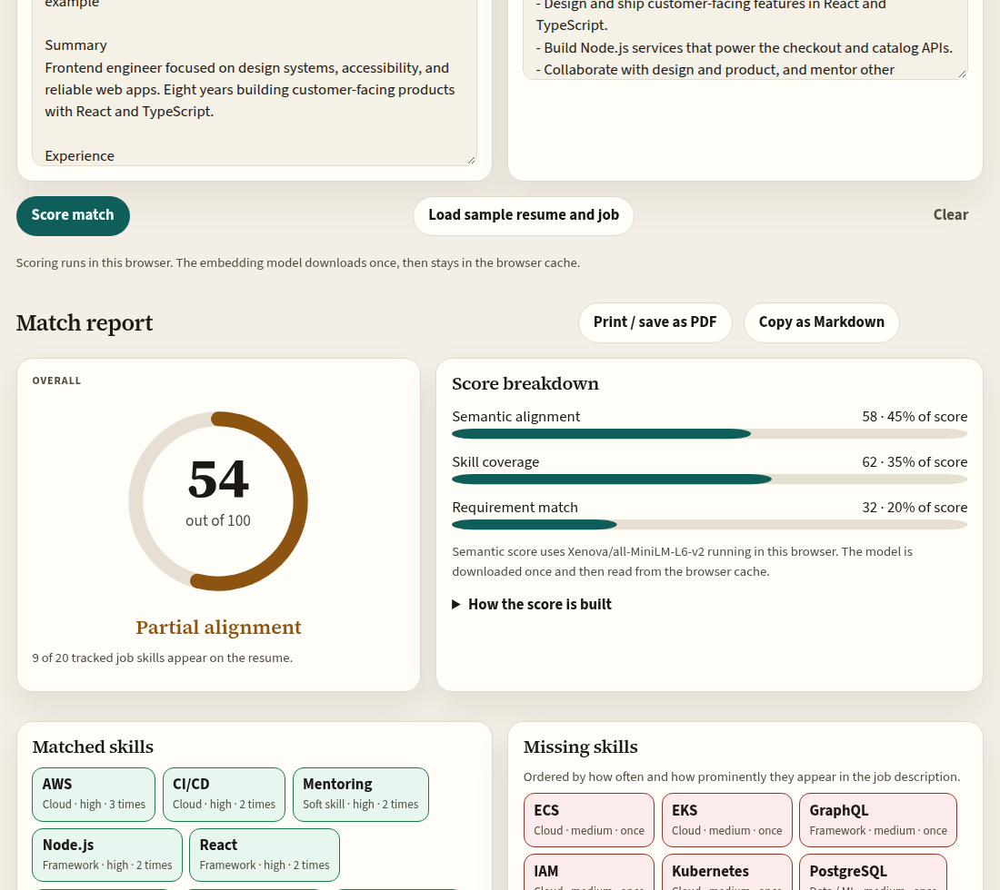
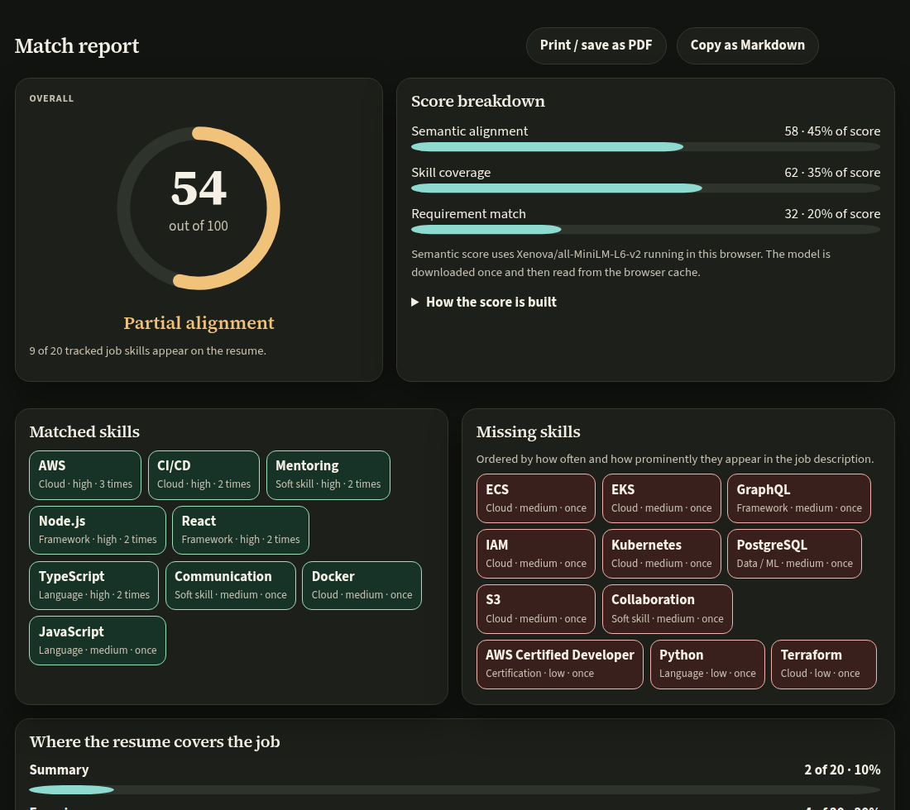

# Resume Match

Resume Match compares a resume with a job description in the browser. Parsing, skill checks, and semantic similarity all run on your device. Nothing is uploaded.

## Features

- Paste a resume, or upload a PDF, DOCX, or plain text file.
- Paste a job description.
- Match score from 0 to 100:
  - Semantic similarity from `Xenova/all-MiniLM-L6-v2` through [Transformers.js](https://huggingface.co/docs/transformers.js). The model is lazy-loaded, shows download progress, and is cached by the browser.
  - Skill and keyword coverage from a curated taxonomy (languages, frameworks, cloud, data/ML, tools, soft skills, and certifications) with synonyms such as `JS` / JavaScript and `k8s` / Kubernetes.
- Overall gauge, score breakdown, matched skills, and missing skills ordered by how often and how prominently they appear in the job description.
- Per-requirement match, with the closest resume line for each job bullet.
- Rule-based rewrite suggestions: stronger action verbs, a placeholder for a real metric, and notes that tell you to add a missing keyword only when the work was real.
- Print view for saving a PDF, and copy the report as Markdown.
- A sample resume and job description.
- Light and dark themes, keyboard access, and a layout that works on a phone.
- The same build works at a domain root and under a subpath such as `/resume/`.

## Screenshots

The sample resume scored against the sample job description.

| Light theme | Dark theme |
| --- | --- |
|  |  |

## Local development

Requires Node.js 22.

```bash
npm install
npm run dev
```

Open the URL Vite prints. The first score downloads the embedding model (about 25 MB). Later scores use the browser cache.

```bash
npm test
npm run build
npm run check:dist
npm run preview
```

`npm test` covers scoring, synonyms, requirement splitting, and rewrite rules. It does not download the embedding model.

## Hosting

`netlify.toml` builds with Node 22 (`npm run build`) and publishes `dist`. Response headers include a content security policy that allows in-browser WASM and the Hugging Face model CDN.

Vite is configured with `base: './'`, so script, style, font, PDF worker, and WASM URLs are relative to the document. The same `dist` works in both of these places:

- `https://resume.aiteksolutions.net/`
- `https://aiteksolutions.net/resume/` when the main site proxies that folder to the subdomain

Example rewrite on the main site:

```
/resume/*   https://resume.aiteksolutions.net/:splat   200
/resume/    https://resume.aiteksolutions.net/         200
```

Redirect `/resume` to `/resume/` so relative URLs stay inside the folder.

To check both mounts locally after a build:

```bash
npm run build
python3 -m http.server 4173 --directory dist
```

In another directory that contains a copy of `dist` at `resume/`:

```bash
mkdir -p /tmp/resume-host
rm -rf /tmp/resume-host/resume
cp -a dist /tmp/resume-host/resume
python3 -m http.server 4174 --directory /tmp/resume-host
```

Open `http://127.0.0.1:4173/` and `http://127.0.0.1:4174/resume/`. Asset requests should stay under each of those URLs (`./assets/...`, `./ort/...`, `./pdf.worker.min.mjs`).

## Tech stack

- [Vite](https://vite.dev/), React, and TypeScript
- [Transformers.js](https://huggingface.co/docs/transformers.js) (`@huggingface/transformers`) with `Xenova/all-MiniLM-L6-v2`
- [PDF.js](https://mozilla.github.io/pdf.js/) for PDF text and [Mammoth](https://github.com/mwilliamson/mammoth.js) for DOCX
- Vitest for the scoring tests

ONNX Runtime WASM is copied into `ort/` at build time and loaded relative to the page. The embedding model files are fetched from the Hugging Face CDN the first time you score.

## Privacy

Your resume never leaves your device. There is no application server and no account. Text is read in the browser. The only network requests are for the static app and, the first time you score, the public embedding model. After that, the model is served from the browser cache. Skill matching, requirement alignment, and rewrite suggestions are local.

The score is a decision aid. The taxonomy can miss a niche tool, the embedding model is small, and a suggestion is a template rather than a claim about your career. Scanned PDFs without a text layer need to be pasted as text.

## License

[MIT](LICENSE) © gmahi9
